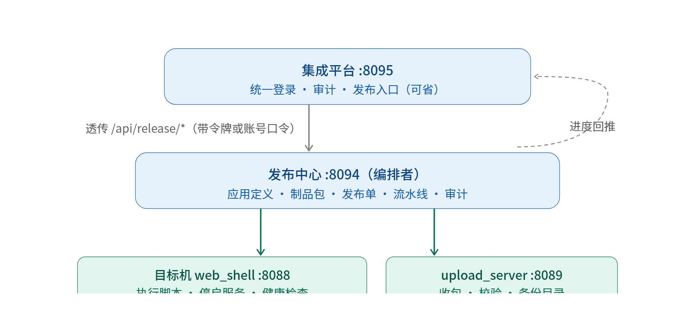
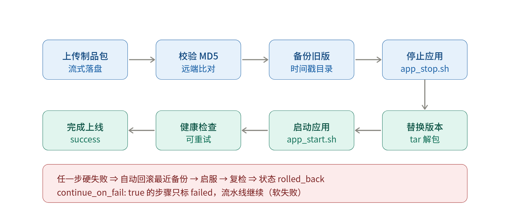

# 发布中心（release_center）使用手册

> 定位：管理机侧的**发布编排服务**，把「上传包 → 备份旧版 → 停服 → 替换 → 启服 → 健康检查 → 失败自动回滚」
> 串成一条可自定义、可追溯、可实时看进度的流水线。
> 自身不落地业务文件，动作全部下发给目标机的 `web_shell`(:8088) 与 `upload_server`(:8089) 探针执行。

| 项目 | 说明 |
|---|---|
| 入口 | `platform_console/release_center.py` |
| 默认端口 | `:8094` |
| 版本 | v1.3.2（命令走 POST + 上传目录按请求指定；支持批量/目录上传、多包发布单） |
| 依赖 | 仅标准库 + `opslib` 公共层，Python **2.7.5+ / 3.7.5+** 双版本兼容 |
| 角色 | `admin` / `ops` / `viewer`，另支持 `--token` 开放令牌 |
| 与集成平台 | 平台只是统一入口，**可以不启**；不启时可直接访问发布中心页面 |

---

## 一、启动与「平台怎么连上它」

### 1.1 启动命令

```bash
# 发布中心（:8094）
python release_center.py --port 8094 --token <T> \
    --platform-url http://<平台IP>:8095 --platform-token <PT> \
    --admin-password <管理员口令>
```

常用参数（均可用同名环境变量代替，见括号）：

| 参数 | 默认值 | 说明 |
|---|---|---|
| `--host` | `0.0.0.0` | 监听地址（`RC_HOST`） |
| `--port` | `8094` | 监听端口（`RC_PORT`） |
| `--token` | 空 | 开放接口令牌，给 CI/CD 免登录调用（`RC_TOKEN`） |
| `--data-dir` | 脚本旁 `data/` | 数据目录（`RC_DATA`） |
| `--pidfile` | 空 | PID 文件（`RC_PIDFILE`） |
| `--platform-url` | 空 | 联动集成平台地址，用于进度回推（`RC_PLATFORM_URL`） |
| `--platform-token` | 空 | 联动平台令牌（`RC_PLATFORM_TOKEN`） |
| `--admin-password` | 空 | 设置/重置 admin 口令（`RC_ADMIN_PASSWORD`） |
| `--reset-admin-password` | 关 | 强制重置 admin 口令后启动 |
| `--no-login` | 关 | 关闭登录要求（全开放，仅供内网演示） |

### 1.2 平台侧凭据（二选一）

平台后端的读法与优先级：**`--release-token` > 设置页「发布中心令牌」> 设置页「账号 + 口令」自动登录**。

| 方式 | 填什么 | 适用场景 |
|---|---|---|
| 令牌 | 与发布中心 `--token` 同值 | CI/CD 无人值守，改完即用、无需重启服务 |
| 账号 + 口令 | 发布中心的管理员账号（如 `admin` / `Admin_123!`） | 人在页面上操作；平台自动登录并缓存会话到 `data/release_session.json`，会话失效自动重登 |

### 1.3 连通性自检

- 平台设置页地址框下方会**实时**显示三态：在线 / 已连通但未授权(401) / 离线。
- 发布视图在「离线」或「未授权」时会给出「⚙ 去设置」直达按钮。
- 一条命令排查：

```bash
curl -H 'X-Auth-Token: <平台令牌>' http://<平台IP>:8095/api/release/config
# 关注 authorized 与 auth_mode（token / login / none）
```

---

## 二、默认流水线（每台机器顺序执行，可选多台并行）

默认步骤链共 6 步，按序执行：

| # | 步骤 | 内置动作 | 说明 |
|---|---|---|---|
| 1 | 上传包 | `@upload` | 把制品包**逐个**流式上传到目标机（多包发布时全部推送，每个都校验远端 MD5） |
| 2 | 备份旧版 | `@backup` | 时间戳目录，回滚的锚点 |
| 3 | 停服 | `@stop` | 执行应用 `stop_cmd` |
| 4 | 替换 | `@replace` | 用新包替换 `target_dir` |
| 5 | 启服 | `@start` | 执行应用 `start_cmd` |
| 6 | 健康检查 | `@health` | `port` / `http` / `cmd` 三种 + 重试 |

要点：

- **备份是回滚的锚点**：按时间戳目录存放，按 `backup_keep` 清理旧备份。
- **自动回滚**：任一步**硬失败** ⇒ 自动回滚最近备份 → 启服 → 复检，状态置 `rolled_back`；也可在页面手动「↺ 回滚」（幂等，无备份时明确报错）。
- **状态机**：`pending` → `running` → `success` / `failed` / `rolled_back` / `canceled`。
  每一步都带状态、消息、耗时、日志，页面通过 **SSE** 实时刷新，无需轮询。
- **并行策略**：发布单 `strategy` 取 `serial`（默认）或 `parallel`；并行时按设置里的 `release_concurrency`（默认 4，范围 1~32）控制并发度。

---

## 三、可自定义的两层（v1.1 / v1.2）

### 3.1 步骤链 `steps` —— 完全替换默认流水线

适合直接贴合现场既有脚本：

```json
{
  "name": "backup",
  "label": "自定义备份",
  "cmd": "./version_backup.sh",
  "continue_on_fail": false,
  "timeout": 600,
  "cwd": "/home/xpe/app"
}
```

- `cmd` 支持 **6 个内置动作**：`@upload` `@stop` `@backup` `@replace` `@start` `@health`；
  其余内容作为 **shell 命令**下发到目标机 `web_shell` 执行（执行前先做 `${var}` 替换）。
- `continue_on_fail: true` = **软失败**（标 `failed` 但继续往下跑）；硬失败仍触发自动回滚。
- 约束：最多 **16** 步；`name` 只允许字母/数字/`_`/`-`，长度 1~32。
- **九步标准模板**：`GET /api/presets` 提供可直接载入的现场部署链，前端一键填充后按现场改路径即可：

  ```
  拉版本包 → app_stop.sh → version_backup.sh → update_before_dist.sh
  → tar 解包 → xpe_pre_install_ccbh.sh → update_after_dist.sh app
  → app_start.sh → @health
  ```

  模板同时带两个必填参数：`Version_All`（版本号，如 `3.2.0`）、`NPkg`（包序号，如 `01`）。

### 3.2 发布参数 `param_defs` —— 每次发布填一次

在应用定义里声明 `key / label / default / required`，建单时填值，命令中用 `${key}` 引用。

**合并优先级：内置变量 > 发布单 `params` > 应用 `vars`。**

- 缺必填、传未知键都返回 **400**（前端也会拦必填）。

### 3.3 应用字段速查

| 字段 | 作用 |
|---|---|
| `biz` | 业务域/分组 |
| `target_dir` | 目标机部署目录（替换/回滚的落点） |
| `package` | 包名匹配模板 |
| `backup_dir` / `backup_keep` | 备份目录 / 保留份数（默认 5，0~999） |
| `release_cmd` | 自定义发布命令（覆盖内置替换） |
| `stop_cmd` / `start_cmd` | 停服 / 启服命令 |
| `health_type` / `health_target` / `health_retry` / `health_interval` | 健康检查方式、目标、重试次数与间隔 |
| `rollback_cmd` | 自定义回滚命令 |
| `vars` / `param_defs` / `steps` | 固定变量 / 逐单参数 / 自定义步骤链 |

---

## 四、制品包：批量上传与多包发布（v1.3 / 平台页 v2.0.5）

> 制品包上传与「建单多选包」在**两个入口**都可用，行为一致：
> ① 发布中心独立页（`:8094`）的「制品包 → 上传制品包」；
> ② 集成平台（`:8095`）「发布中心」视图 —— 制品包面板右上角「＋ 上传」，或把文件 / 文件夹**直接拖到制品包列表上**。
> 平台页是经 `release_upload_proxy` **流式透传**到发布中心的（不受 `req.raw_body()` 的 32MB 上限约束，内存占用与包大小无关）。

### 4.1 上传：拖拽 / 多选 / 整目录

上传弹窗支持三种来源，都进同一条上传队列：

| 方式 | 操作 |
|---|---|
| 拖拽文件 | 直接把文件拖进虚线框 |
| 拖拽文件夹 | 把文件夹拖进去，**递归**上传其中所有文件 |
| 选择多个文件 | 「选择多个文件」按钮（`multiple`） |
| 选择整个目录 | 「选择整个目录」按钮（`webkitdirectory`，带子目录层级） |

队列特性：

- **并发上传**：默认 2 路并发（弹窗里可选 1~4），每文件一条进度，整体有进度条；可随时「停止」。
- **队列内去重**：同一来源拖两次只会入队一次；`.DS_Store` / `Thumbs.db` / `desktop.ini` 自动忽略。
- **按 MD5 跳过重复包**：勾选「跳过内容相同的包」（默认开）时，内容与已有包一致的直接复用，整目录重复上传不会堆出 `a_1.tgz`、`a_2.tgz` 副本。
- **来源可溯源**：目录上传会记录相对路径（`src`，如 `pkg/2024/主程序.tgz`），在制品包列表里显示。
- **不留脏文件**：服务端先把请求体写进隐藏的 `.part` 临时文件，算完 MD5 才 rename 转正 —— 上传中断不会留下半个包污染列表。

> 批量上传由前端**按文件逐个调用** `POST /api/packages/upload`（每个文件一次请求），因此单文件失败不影响其余文件，界面会逐个标出成功 / 失败 / 已存在（跳过）。

### 4.2 多包发布：一个发布单挂多个包

有的现场是「主程序包 + 配置包」或「版本包 + 补丁包」一起发，建单时制品包改成**多选**（带筛选框、全选 / 清空、以及「只看所选应用」，切应用时自动勾上该应用自己的包）：
（平台页同样如此：`packages` 数组提交，`package` 保留第一个包以兼容旧模板。）

- 提交上限 **32** 个；`packages` 是权威列表，`package` 字段保留为第一个包，兼容老模板与老前端。
- `@upload` 会把它们**按顺序全部**推到目标机，任一个失败即整步失败（照旧触发回滚），每个包的远端 MD5 都会校验并在步骤日志里逐条留痕。
- 命令模板里新增这些变量（`${package}` 语义与单包时代完全一致，旧模板不用改）：

| 变量 | 含义 |
|---|---|
| `${package}` | 第一个包的远端路径 |
| `${packages}` | 全部包的远端路径，空格分隔 |
| `${package1}` … `${packageN}` | 逐个点名引用 |
| `${package_count}` | 包数量 |

例：Windows 目标机上把两个包各就各位

```bat
(if not exist "${target_dir}" mkdir "${target_dir}") ^
 & copy /Y "${package1}" "${target_dir}\主程序.bin" >NUL ^
 & copy /Y "${package2}" "${target_dir}\配置.bin" >NUL
```

---

## 五、一次上线的标准动作顺序

1. 启动发布中心（带 `--token`，或准备好管理员账号）。
2. 平台设置里配 **发布中心地址 + 凭据**。
3. 「服务器墙」纳管目标机（需具备 `web_shell` / `web_shell + upload` 能力）。
4. 「应用」里配 `target_dir` / 包名模板 / 备份目录 / 停启替换命令 / 健康检查（或载入九步模板）。
5. 声明 `param_defs`。
6. 上传制品包（拖拽 / 多选 / 整目录；流式落盘 + 自动 MD5）。
7. 建发布单（应用 + 版本 + **可多选**制品包 + 目标机 + 串并行 + 参数）。
8. 点「▶ 执行发布」，实时看步骤日志；异常则自动或手动回滚。
  
---

## 六、权限与可追溯

- **角色权限点**：`admin`（`*`）/ `ops`（可操作与发布，不可管用户）/ `viewer`（只读）；另支持 `--token` 开放令牌。
- **审计链**：所有写操作进入哈希链审计。
  - `GET /api/audit` 查看流水
  - `GET /api/audit/verify` 校验链完整性
  - `GET /api/audit/export.csv` 导出
- **进度回推**：步骤状态变化会 `POST <platform_url>/api/events/push` 回推集成平台，页面不轮询也能看到进度。

### 6.1 接口速查

| 分组 | 接口 | 权限 |
|---|---|---|
| 探活 | `GET /api/ping`、`GET /api/health`、`GET /api/openapi.json`、`GET /` | 免鉴权 |
| 身份 | `POST /api/login`、`POST /api/logout`、`GET /api/me`、`GET /api/roles` | 登录/`me` 免鉴权；`logout`、`roles` 需登录 |
| 应用 | `GET/POST /api/apps`、`PUT/DELETE /api/apps/<name>`、`GET /api/presets` | `server.view` / `server.edit` |
| 制品包 | `GET /api/packages`、`POST /api/packages/upload`（`filename/app/version/src/skip_dup`）、`DELETE /api/packages/<name>` | `server.view` / `release.run` |
| 目标机 | `GET/POST /api/servers`、`PUT/DELETE /api/servers/<name>`、`POST /api/servers/import` | `server.view` / `server.edit` |
| 发布单 | `GET/POST /api/orders`、`GET /api/orders/<id>`、`POST /api/orders/<id>/{run,rollback,cancel}`、`GET /api/orders/<id>/stream` | `server.view` / `release.run` |
| 事件 | `GET /api/events` | `server.view` |
| 审计 | `GET /api/audit`、`/api/audit/verify`、`/api/audit/export.csv` | `audit.view` |
| 设置 | `GET/POST /api/settings` | `settings.edit` |

> 关键设置项：`platform_url`、`platform_token`、`release_concurrency`（默认 4，1~32）、`cmd_timeout`（默认 120s，1~600）、`backup_keep_default`（默认 5，0~999）。

---

## 七、已知问题与修复记录

### v1.3.2 · 命令改走 POST、上传目录按请求指定

- **命令执行改走 POST（配套 web_shell v1.3.0）**：发布步骤执行命令改用 `POST /api/exec/stream`（命令在 JSON 体、令牌走 `X-Auth-Token`），URI 上不再出现 `cmd=`——消除「URI 带命令」被态势感知 / IDS 误判为 webshell 的问题。**退避链带防重放**：仅当「建连失败且一个事件都没收到」时才退回旧 `GET ?cmd=`（否则「重启服务」这类命令会被执行两次），再不行退同步 `/api/exec`。
- **上传目录按请求指定**：`/api/chunk/put|init|complete`、`/api/upload` 支持 `dir`（绝对路径），配合 upload_server v3.3.0 的 `--allow-client-dir` 按次落盘；步骤首包落地后比对「声明目录 vs 真实目录」，不一致时给出「开 `--allow-client-dir` / 重启 `--upload-dir`」双解法提示。
- **验证**：集成 **212/212**、自检 **114/114**；目录覆盖冒烟 **10/10**（落指定目录 / 分片 complete 沿用 init 记录 / 相对路径 400 / 未开开关忽略 dir）。

### v1.3.0 · 制品包上传与多包发布

- 支持拖拽 / 多选 / 整目录上传（并发队列 + 逐文件进度 + 可停止），服务端改为「先落 `.part` 临时文件 → 算 MD5 → 再决定去留」：`skip_dup=1` 可跳过内容相同的包，中断上传不留脏文件，目录上传记录来源相对路径 `src`。
- 发布单支持多选制品包（`packages`，上限 32），`@upload` 逐个推送并注入 `${package}` / `${packages}` / `${package1..N}` / `${package_count}`。
- **同时修掉两个 Windows 静默失效**：`if not exist X mkdir X & <后续命令>` 在 **X 已存在**（二次发布 / 回滚时目标目录必然存在）时，cmd 会把 `&` 后面的命令**整行跳过**，于是「备份没做、回滚没还原」，而两边都报成功。备份与回滚命令改为 `(if ...)` 括号写法。

### v2.0.5 · 平台页「上传制品包没有拖拽/多选」「大包报 413」「筛选点了没反应」

- **现象**：平台「发布中心」页只有「创建发布单」按钮，没有上传入口，建单时制品包是单选；
  另外（改完上传后）大包报 `413 请求体过大(上限 32MB)`，「只看所选应用」等筛选毫无反应。
- **真因**：此前只改了发布中心独立页 `templates/release_center.html`，**平台页是另一套前端**
  （`static/index.html` + `static/app.js`），仍是旧版；透传层又有两个静默缺陷 ——
  ① 普通透传用 `req.raw_body()` 默认封顶 32MB 且整包进内存；
  ② `req.parsed.query` 恒为空串（query 被 `dispatch` 剥掉），转发时查询串被静默丢弃。
- **修复**：平台页补齐拖拽（含文件夹递归）/ 多选 / 整目录上传队列与建单多选包；
  新增 `release_upload_proxy` 流式透传；统一改用 `req_query(req)`（= `raw_query`）。
- **验证**：集成 **170/170**（新增 22 项：34MB 经平台直传、查询串过滤生效、代理上传判重、
  平台页前端逻辑 12 项）；自检 **99/99**（新增两条静态兜底）；py2 语义 **31/31**。
  反证：把查询串改回 `parsed` / 去掉流式上传路由，对应断言立刻 FAIL 8 项。

### v2.0.4 · 「登录成功后被踢出、反复登不进去」

- **现象**：平台页面退出后无法登录，或点任意发布相关操作就被弹回登录页。
- **真因**（不是口令问题）：平台 → 发布中心的请求**没带凭据**收到 401，又被平台 `release_proxy` **原样透传**；前端按惯例把 401 判成「平台会话失效」→ 弹回登录页 → 形成死循环。
- **修复**：
  1. 平台侧把上游 401/403 统一翻成 **502 `{code:"upstream_unauthorized"}`** 并附排查指引，前端不再误判为平台会话失效。
  2. 新增「**发布中心账号 / 口令自动登录**」：设置页填完即用，**不用重启任何服务**；会话缓存 + 失效自动重登。
- **验证**：集成 **119/119**（新增 14 项，含一个「刻意不给令牌」的探针实例）、自检 **96/96**、py2 语义 **25/25**；前端 401 策略用 Node 真跑了一遍 `api()`，并以「换回旧实现」反证会 FAIL。

### 升级部署提醒

同步 `opslib/`（含 `compat.py`、`server.py`、`auth.py`、`sse.py`、`httpx.py`）+ `platform_console/`（`ops_Platform.py`、`release_center.py`、`static/app.js`、`index.html`、`app.css`、`templates/release_center.html`）+ `tools/`（`web_shell.py`、`upload_server.py`、`templates/web_shell.html`）到目标机，重启平台 **:8095**（横幅应显示 **v2.0.8**）与发布中心 **:8094**（横幅应显示 **v1.3.2**），浏览器 `Ctrl+F5` 强刷。设置页填好发布中心账号 + 口令即可自动登录，**免重启**。目标机侧 `web_shell` 升到 **v1.3.0**、`upload_server` 升到 **v3.3.0**（如需按请求指定上传目录，启动加 `--allow-client-dir`）后，命令与上传链路才享受 POST / 目录覆盖能力。

---

## 附：示意图




